# 当前 CAN RTT 耗时构成分析

分析日期：2026-10-28。依据为2026-10-27的最终4kHz/8kHz原始CSV和对应代码，
本次没有新增硬件测量、刷写或发送CAN命令。

## 能确定什么

8kHz测得平均933.962µs、P99=999.882µs、最大1124.419µs。
现在只能准确测出主机发送API前至接收API返回的合计时间；CSV没有中间阶段时间戳，
不能把剩余耗时直接归给DM、电机内部算法、IgH或者MCU。

当前记录的边界：

- t0在PDO编码、复制和domain_queue之后，`ecrt_master_send()`之前。
- t1在`ecrt_master_receive()`返回后，`ecrt_domain_process()`及反馈解析之前。
- RTT=t1−t0，两个时间戳使用同一NUC单调时钟。
- 因此不包含控制器生成命令后等待下一次发送的时间，也不包含反馈解析/发布到控制器、
  控制线程下一次实际使用反馈的时间。完整控制链路延迟通常会比本测试更大。

```mermaid
flowchart LR
    A[NUC发送API前 t0] --> B[IgH与NIC发送]
    B --> C[ESC接收与主循环取RxPDO]
    C --> D[协议校验和CAN提交]
    D --> E[CAN仲裁与命令串行传输]
    E --> F[DM处理]
    F --> G[CAN反馈仲裁与串行传输]
    G --> H[MCAN接收中断及反馈队列]
    H --> I[反馈采集与TxPDO发布]
    I --> J[后续EtherCAT帧及NUC收包轮询]
    J --> K[接收API返回 t1]
    K --> L[解析与控制器使用:当前计时范围外]
```

## 证据与估算分别看

| 环节 | 当前证据或量级 | 限制 |
|---|---|---|
| 总RTT | 平均933.962µs | 已实测，仅包含上述t0至t1 |
| 交换节拍 | 125µs；96.6%的样本靠近875或1000µs | 已从CSV核对，证明周期量化明显，不等于全程都在等待 |
| 发送时的唤醒迟到 | 最大0.169µs | 仅对应发送命令那一轮；没有记录接收侧唤醒和内核/NIC时延 |
| EtherCAT上线序列化 | 布局规划值48µs：Rx96B+Tx400B、估算2帧、100Mbps | 是带宽规划估算，不是实测网络RTT，不能直接从总RTT中扣除并给其它阶段分账 |
| 两个经典CAN标准8字节帧 | 1Mbps下总线占用约222–270µs，含帧间隔及位填充范围 | 理论估算，不含仲裁排队、错误重传、DM处理、中断响应 |
| 主从软件、DM处理、PCIe与仲裁排队 | 尚无独立实测数值 | 不能伪造细分百分比 |

经典CAN估算方法：标准8字节数据帧未填充时，含帧间隔约111bit；加上位填充，
按约135bit的保守上界估算。1Mbps即1µs/bit，命令与反馈各一帧。
这是无错误场景的帧占用量级，不是含仲裁和重传的RTT上界。
协议字段、仲裁和位填充背景见[Kvaser官方CAN教程](https://kvaser.com/can-protocol-tutorial/)。

## 周期量化非常明显

按最接近的125µs倍数分桶，8kHz的1000个样本为：

| 近似RTT | 周期数 | 样本数 |
|---|---:|---:|
| 625µs | 5 | 6 |
| 750µs | 6 | 24 |
| 875µs | 7 | 458 |
| 1000µs | 8 | 508 |
| 1125µs | 9 | 4 |

分桶是对连续值四舍五入，不是精确RTT；另有5个样本略高于1000µs但仍在8周期桶内，
所以超过1ms的总数为9，不是4。

4kHz的样本则主要落在4和5个250µs周期：452+534=986个，占98.6%。
相同最终固件、优化编译、FIFO40和临时ASPM关闭条件下，4kHz到8kHz平均RTT减少195.775µs。
这支持优先检查收发/发布相位，但不能证明某一个等待点独占195.775µs。

## 代码中的等待和盲点

1. 主站每周期先Receive，再处理输入、构造输出，最后Send。
   `ecrt_master_receive()`按周期调用，NIC上已经返回的反馈仍可能等到下一次轮询才被观察到。
2. 从站OP时仅在新RxPDO、状态变化等条件下采集并发布反馈。
   CAN中断在两个RxPDO之间到达时，反馈入队并不等于马上写入ESC输入区，存在等待下一个交换的机会。
3. SSC FreeRun先处理输出和应用，再进行输入映射；EtherCAT帧对SM2/SM3的访问和CPU更新未同步。
   是否赶上本帧的输入读取取决于相位，不能假定“发命令的这帧会带回相应反馈”。
4. 主循环末尾的10µs忙等只是额外等待，并不保证MainLoop每10µs执行一次；
   还要加上应用、映射、中断、周期性PHY查询等执行时间。
5. CAN接收过滤器不减少物理总线上的其它帧。
   之前CAN3约10秒收到了约1万帧，抽样是DJI 0x201；如果其在RTT测试时仍发送，
   它仍会占总线，即使本台架只保留DM 0x013。是否持续存在以及实际仲裁等待还需抓包。
6. 当前从站`Now()`使用`k_uptime_ticks()`，构建的tick频率为10000Hz，时间量化约100µs。
   现有slave_now_us/capture_time_us不足以精细拆解几十微秒的阶段，且不能与NUC时间直接相减。
   硬件计时频率为24MHz，可以另设高分辨率诊断时钟；应验证周期计数API和换算，
   不应为了测量顺手更改业务看门狗时钟。
7. 4kHz/8kHz通过条件包含优化编译、实时调度和临时关闭ASPM。
   没有完整的最终构建ASPM开/关单变量对照，不能把改善全部归给ASPM。

这些等待之间有流水线重叠与相位耦合，不能简单每项加一个125µs再当作精确分解。
同样不能从平均934µs减去估算CAN帧占用后，把剩下的六七百微秒称作“电机处理时间”。

## 下一步应怎样分段测量

不急于先升16kHz。先加低干扰时间戳，按同一个会话和CAN命令批次关联：

| 时钟域 | 测量点 |
|---|---|
| NUC | 命令生产；Send入口/返回；Receive入口/返回；domain_process完成；反馈解析发布；控制器首次消费 |
| MCU | RxPDO映射完成；命令接纳；CAN提交；TX完成回调；目标CAN反馈接收；反馈入快照；ESC输入区写入 |

MCU使用独立高分辨率计时，不在ISR/MainLoop逐条打印；可以用64/128条预分配记录，
结束后统一读取，避免缓冲、日志、JTAG暂停或动态分配污染RTT。
同时保存exchange/batch、发布序号、CAN接收序号，区分旧快照与新反馈。

可先独立测得：

- MCU映射至CAN提交：本地协议和转发耗时。
- MCU CAN提交至接收回调：总线排队+命令/反馈线时+DM处理+中断延迟的合计。
- MCU接收回调至ESC输入发布：回程排队、采集和发布等待。
- NUC Receive返回至控制器消费：当前RTT没有覆盖的控制侧延迟。

TX完成回调包含中断响应时间，不能把它当作精确CAN EOF；也不能把CAN ACK当作电机状态应答。
若要再分离DM处理，需CAN硬件时间戳或分析仪测量命令EOF到反馈SOF，并另外考虑仲裁等待。
未做DC/PTP或其它时钟标定前，不直接把NUC时间与MCU时间相减来计算单向网络延迟。
